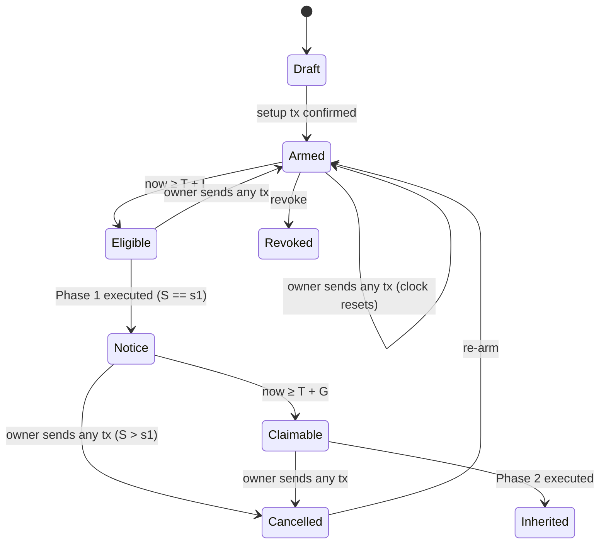

# Riktha — Architecture

Companion to `PRD.md` (what and why) and `PROGRESS.md` (task tracker).
This document is the build spec: if it isn't here, decide it in `PROGRESS.md → Decision log` and update this file.

---

## 0. Ground rules

1. **The chain is the source of truth.** Plan state is always *derived* from the owner's account on Horizon. The DB caches state and stores contacts, nothing authoritative.
2. **No user private keys ever touch the server.** Users sign in Freighter.
3. **All transaction building lives in one pure, isomorphic module** (`lib/core`), unit-tested, used by both browser and server.
4. **Everything that matters gets a testnet tx hash** recorded for `/evidence`.

---

## 1. Stack (decided)

| Layer | Choice | Why |
|---|---|---|
| App | **Next.js (latest stable), App Router, TypeScript, Tailwind CSS** | One deploy on Vercel for UI + API |
| Stellar | **`@stellar/stellar-sdk`** (latest; pin exact version at install) | `TransactionBuilder` supports `setMinAccountSequence`, `setMinAccountSequenceAge`, `buildFeeBumpTransaction`; `WebAuth` for SEP-10 challenges |
| Wallet | **`@stellar/freighter-api`** directly (Freighter only in MVP) | Fewest moving parts. Stellar Wallets Kit is a stretch goal. |
| DB | **Neon Postgres** (Vercel Marketplace, free) + **Drizzle ORM** | Serverless-friendly, typed schema |
| Auth | SEP-10-style challenge (`WebAuth.buildChallengeTx` / `readChallengeTx` / `verifyChallengeTxSigners`) → JWT in httpOnly cookie (`jose`) | Stellar-native sign-in, no passwords |
| Email | **Nodemailer over SMTP** (provider-agnostic; Gmail with an app password works with no domain; Brevo/Resend later) | Sam has no domain yet |
| Telegram | Bot API via `fetch`, webhook at `/api/telegram/webhook` | Free, no domain |
| Scheduler | **cron-job.org** (free) calling `/api/cron/tick` **every minute** with a bearer secret. Vercel cron once daily as a backup. | Vercel Hobby limits cron to **once per day** with ±59 min precision, which is too coarse for the 2-minute demo windows |
| Validation | `zod` | API input validation |
| Tests | `vitest` (unit) + `tsx` scripts for live testnet scenarios | Fast; scenarios produce evidence hashes |
| Package manager | `pnpm` | |

---

## 2. Protocol design (the heart of Riktha)

### 2.1 Facts we rely on (verified against docs/spec)

| Fact | Source |
|---|---|
| `minSeqNum`: valid when `minSeqNum <= S < tx.seqNum`; without it S must equal `tx.seqNum - 1`. After execution the account's seq is set to `tx.seqNum`. | Stellar docs, Operations & Transactions; CAP-21 |
| `minSeqAge`: valid only if ledger time ≥ account `seqTime` + minSeqAge. Failure code `txBAD_MIN_SEQ_AGE_OR_GAP` (-15). | CAP-21 |
| `seqTime` is updated for the source account of **every executed transaction**, and by every `BumpSequenceOp` even if it doesn't change the number. Accounts without the V3 extension behave as `seqTime = 0`. | CAP-21 |
| A pre-auth signer is removed when a matching tx **is applied, success or failure**. A tx rejected before application (e.g. unmet preconditions) does **not** remove it. | CAP-28; Stellar docs, Signatures & Multisig |
| Thresholds: BumpSequence = low; Payment/ChangeTrust = medium; SetOptions/AccountMerge = high. New accounts: thresholds 0/0/0, master weight 1. | Horizon account object docs; multisig docs |
| Each extra signer raises minimum balance by one base reserve. | Multisig docs |
| Extra valid signatures beyond what's needed fail with `txBAD_AUTH_EXTRA`. | Multisig docs |
| Fee-bump: fee source signs outer; inner keeps its signatures and sequence; inner validity is checked again at apply; outer fee ≥ inner fee and ≥ network minimum for (inner ops + 1). | Fee-bump docs |
| Sponsorship sandwich: `BeginSponsoringFutureReserves` source = sponsor (sponsor signs), `EndSponsoringFutureReserves` source = sponsored account (it signs). Signers are sponsorable. | Sponsored reserves guide; CAP-33 |
| Soroban authorizes a classic G address through its classic signers at the **medium** threshold. | Soroban authorization docs |
| Horizon account object exposes `sequence`, `sequence_ledger`, `sequence_time`, `signers[{key, weight, type: preauth_tx…}]`, `thresholds`, `subentry_count`, `num_sponsoring`, `num_sponsored`. | Horizon account object docs |
| `TransactionBuilder.build()` requires timebounds or `setTimeout(TimeoutInfinite)` (= 0). | js-stellar-base source |

### 2.2 Spike results (PROGRESS T0.2, run 2026-10-08)

SP1–SP5 confirmed on testnet: see PROGRESS → Spike results for tx hashes. **Outcome: `SEQ_JUMP = 1e9`; the plain variant is the default; no reserve guard is needed.** SP6/SP7 (Freighter signs PreconditionsV2 and fee-bumps) also passed.

Original questions:

| ID | Question | Default assumption | Fallback |
|---|---|---|---|
| SP1 | Is a Phase 1 seq of `X + 1_000_000_000` accepted? (Core rejects seq numbers "too high"; the exact limit isn't documented.) | Yes, for any account older than 1 ledger | Halve the jump until accepted; record the limit |
| SP2 | Is `sequence_time` returned by Horizon and updated by the setup tx? | Yes | Use the timestamp of the account's latest transaction |
| SP3 | Does the **sponsored** Phase 2 (heir sponsors the new signer) succeed? | Yes | Use the **plain** variant + reserve guard |
| SP4 | Does the **plain** Phase 2 succeed when the owner has exactly the minimum balance? | Unknown (is the pre-auth signer removed before ops run?) | Reserve guard warns owner to keep 0.5 XLM spare |
| SP5 | Exact Horizon error string for unmet `minSeqAge` (expected `tx_bad_minseq_age_or_gap`, inside `tx_fee_bump_inner_failed` when fee-bumped) | As expected | Map whatever is observed |
| SP6 | Does Freighter sign an XDR with PreconditionsV2 (Phase 2 sponsored, heir signs)? | Yes | Heir signs via Stellar Lab, or plain variant (no heir signature needed) |
| SP7 | Does Freighter sign a **fee-bump** envelope? | Unknown (docs are silent) | Submit Phase 1/2 inner-only; the owner pays the fee (verified on testnet) |

### 2.3 Notation

- `C` = owner's current sequence number when building the plan.
- `X = C + 1` = owner's sequence after the setup tx executes.
- `J = 1_000_000_000n` = sequence jump (constant `SEQ_JUMP`, adjusted by SP1).
- `s1 = X + J` = Phase 1 sequence number. `s2 = s1 + 1` = Phase 2 sequence number.
- `W = max(1, owner.thresholds.high_threshold)` = weight for pre-auth signers and the heir signer.
- `I` = inactivity window (seconds); `G` = grace window (seconds).

The owner can send `J - 1` (≈1 billion) transactions before Phase 1 stops being reachable, which is effectively unlimited.

### 2.4 The four transactions

All built with `networkPassphrase` of the target network, fee `BASE_FEE` per op, `setTimeout(TimeoutInfinite)`.
Build with `new Account(owner, (seq - 1n).toString())` because the builder increments the sequence.

**Phase 1 — Notice** (source: owner, seq `s1`, **no signatures**)
```
preconditions: minSeqNum = X, minSeqAge = I
ops:  BumpSequence(bumpTo = "0")        // no-op; low threshold; cannot fail
memo: text "riktha:notice"
```

**Phase 2 — Handover**, variant **sponsored** (supported, not the default) (source: owner, seq `s2`)
```
preconditions: minSeqAge = G            // no minSeqNum ⇒ requires S == s1 exactly
ops:  BeginSponsoringFutureReserves(sponsoredId = owner)   source = heir
      SetOptions(signer = {ed25519PublicKey: heir, weight: W})   source = owner
      EndSponsoringFutureReserves()                         source = owner
memo: text "riktha:handover"
signatures at submit time: heir signs the INNER tx (needed for op 1)
```

**Phase 2 — Handover**, variant **plain** (**default**, chosen after SP4: Phase 1 frees one reserve before Phase 2 can run, so adding the heir signer can never fail on reserves)
```
preconditions: minSeqAge = G
ops:  SetOptions(signer = {ed25519PublicKey: heir, weight: W})
memo: text "riktha:handover"
signatures at submit time: NONE on the inner tx (an heir signature here would cause txBAD_AUTH_EXTRA)
```

**Setup** (source: owner, seq `X`, owner signs in Freighter)
```
ops:  [for each stale Riktha preauth signer] SetOptions(signer = {preAuthTx: oldHash, weight: 0})
      SetOptions(signer = {preAuthTx: hash(Phase1), weight: W})
      SetOptions(signer = {preAuthTx: hash(Phase2), weight: W})
timeout: 300 s
```
The same builder serves **create**, **re-arm** and **edit**. **Revoke** = only the removal ops.

**Check-in ("I'm alive")**: owner-signed `BumpSequence(bumpTo="0")`, memo `riktha:alive`. Any other sent transaction works equally well.

**Estate transfer** (after handover): tx **source = heir**, op `Payment(destination = heir or chosen, asset, amount)` with **op source = owner**. Heir signs once; their weight W on the owner account authorizes the op. The heir pays the fee from their own account. For a non-XLM asset the heir doesn't hold yet, prepend `ChangeTrust(asset)` with op source = heir (`addTrustline` option); otherwise the payment fails with `op_no_trust`. XLM can't go below the owner's minimum balance (a stretch goal is sweeping it with `AccountMerge`).

### 2.5 Hashes

`hash(tx)` = `txHashHex(tx)` (wraps `tx.hash()`; **SDK 17 returns a `Uint8Array`**, so `.toString("hex")` is wrong; the same applies to text memos, so use `memoText(tx)`) (SHA-256 of the signature payload, which includes the network ID). Store as hex. Signer key in `SetOptions`: `{ preAuthTx: Buffer.from(hashHex, "hex"), weight }`. Horizon lists it as `type: "preauth_tx"` with a `T…` StrKey (`StrKey.encodePreAuthTx(hash)`).

### 2.6 Submission

- Phase 1 and Phase 2 are submitted **wrapped in a fee-bump** by default: `TransactionBuilder.buildFeeBumpTransaction(feeSource, "1000", inner, passphrase)`, signed by the fee source.
  - **Inner-only fallback** (verified, SP5b): the pre-auth signer makes the inner tx valid alone, and the owner pays the 100-stroop fee. Use it when `ownerCanPayFee` is true and fee-bump signing isn't available (SP7). After Phase 1 the owner always has ≥ 1 freed reserve, so Phase 2 inner-only is always payable.
  - Phase 1 fee source: keeper account (auto), or the heir, or anyone (packet page).
  - Phase 2 fee source: the heir.
- Submission goes from the **browser directly to Horizon** for user actions, and from the server for the keeper.
- Map errors: `tx_fee_bump_inner_failed` + inner `tx_bad_minseq_age_or_gap` → "Not yet: available from {date}"; inner `tx_bad_seq` → "This plan was cancelled by the owner".

### 2.7 State machine (derived)

Inputs: Horizon account (`sequence S`, `sequence_time T`, `signers`), plan (`s1`, `h1`, `h2`, `heir`, `I`, `G`), `now`.



Derivation (first match wins; implemented in `lib/core/state.ts`):
```
heirIsSigner                                   → INHERITED
!has(h1) && !has(h2):
     S < X                                     → DRAFT       (setup not executed yet)
     S == s1                                   → BROKEN
     else                                      → REVOKED     (incl. revoke after a cancel; a failed Phase 2 looks the same, so check plan_events)
S < s1 && has(h1) && has(h2):
     now >= T + I                              → ELIGIBLE    (Phase 1 can be submitted)
     else                                      → ARMED       (eligibleAt = T + I)
S == s1 && has(h2):
     now >= T + G                              → CLAIMABLE
     else                                      → NOTICE      (claimableAt = T + G)
S > s1 && !heirIsSigner                        → CANCELLED   (re-arm needed)
otherwise                                      → BROKEN      (show diagnostics)
```
Also computed: `ownerCanPayFee` = available XLM ≥ 0.001 (submit Phase 1/2 inner-only). The original `reserveHealthy` guard was dropped after SP4.

### 2.8 Account eligibility (checked before creating a plan)

- Account exists and is funded on the selected network.
- Signers = master key only, or master key + stale Riktha pre-auth signers (re-arm). Anything else → "Multisig accounts aren't supported yet."
- Master weight ≥ 1 and ≥ all thresholds.
- Available XLM ≥ 2 × base reserve (read from the latest ledger's `base_reserve_in_stroops`, never hardcoded) + 1 XLM buffer.
- Heir ≠ owner; heir account exists (needed for fee-bump and sponsorship).
- Windows: mainnet minimum I ≥ 30 days, G ≥ 7 days. Testnet allows ≥ 60 s ("Demo mode").

---

## 3. System overview

```
┌──────────────── Browser (Next.js client) ────────────────┐
│ Pages: /, /plan/new, /dashboard, /heir, /claim, /evidence│
│ lib/core (builders, state, packet)  ← same code as server│
│ Freighter: sign setup / check-in / phase2 / fee-bumps    │
│ Submits user txs directly to Horizon                     │
└───────────────┬──────────────────────────┬───────────────┘
                │ fetch /api/*             │ Horizon REST
┌───────────────▼─────────── Vercel ───────┴───────────────┐
│ API routes: auth, plans, contacts, telegram, cron        │
│ Keeper (/api/cron/tick): derive state → notify → Phase 1 │
│ Notifiers: SMTP email, Telegram Bot API                  │
└──────┬─────────────────┬─────────────────┬───────────────┘
       │ Drizzle         │ SMTP            │ Bot API
  Neon Postgres     Email provider     Telegram
       ▲
cron-job.org ── POST /api/cron/tick every minute (Bearer CRON_SECRET)
```

---

## 4. Repository layout

```
riktha/
├─ app/
│  ├─ page.tsx                     # landing: problem, how it works, protocol diagram
│  ├─ plan/new/page.tsx            # create wizard
│  ├─ dashboard/page.tsx           # owner
│  ├─ heir/page.tsx                # heir: plans naming me, claim, estate
│  ├─ claim/page.tsx               # packet-only claim (no login, no DB)
│  ├─ evidence/page.tsx            # scenario results + tx links (reads docs/evidence.json)
│  ├─ settings/page.tsx            # email + telegram linking
│  └─ api/
│     ├─ auth/challenge/route.ts   # GET  → challenge XDR
│     ├─ auth/verify/route.ts      # POST → JWT cookie
│     ├─ auth/logout/route.ts
│     ├─ plans/route.ts            # POST create draft (returns XDRs), GET mine
│     ├─ plans/[id]/route.ts       # GET plan + derived state
│     ├─ plans/[id]/confirm/route.ts   # POST setup hash → verify on chain → ARMED
│     ├─ plans/[id]/rearm/route.ts     # POST → new draft version
│     ├─ plans/[id]/revoke/route.ts    # POST → revoke XDR; confirm reuses /confirm
│     ├─ plans/[id]/packet/route.ts    # GET packet JSON (owner or heir)
│     ├─ heir/plans/route.ts       # GET plans where heir = me
│     ├─ contacts/route.ts         # GET/PUT my email; POST resend verification
│     ├─ contacts/verify/route.ts  # GET ?token= → mark verified
│     ├─ telegram/link/route.ts    # POST → deep link token
│     ├─ telegram/webhook/route.ts # POST from Telegram (secret header)
│     └─ cron/tick/route.ts        # POST keeper (Bearer CRON_SECRET)
├─ components/                     # UI (Countdown, StateBadge, TxReview, ConnectButton…)
├─ lib/
│  ├─ core/                        # PURE, isomorphic, unit-tested
│  │  ├─ config.ts                 # network constants, SEQ_JUMP, presets, minimums
│  │  ├─ builders.ts               # buildPhase1/2, buildSetup, buildRevoke, buildCheckIn, buildEstateTransfer, wrapFeeBump
│  │  ├─ state.ts                  # derivePlanState(account, plan, now)
│  │  ├─ eligibility.ts            # checkOwnerAccount, checkHeirAccount
│  │  ├─ packet.ts                 # makePacket, parsePacket (zod), verifyPacket
│  │  ├─ explain.ts                # tx → plain-language summary for review screens
│  │  └─ errors.ts                 # Horizon result codes → user messages
│  ├─ stellar/horizon.ts           # Horizon client, loadAccount raw, baseReserve, submit
│  ├─ wallet/freighter.ts          # connect, getAddress, signTx (wraps @stellar/freighter-api)
│  └─ server/
│     ├─ db/schema.ts, db/index.ts
│     ├─ auth.ts                   # challenge/verify, JWT session helpers
│     ├─ keeper.ts                 # tick algorithm
│     ├─ notify/index.ts           # dispatch + dedupe
│     ├─ notify/email.ts           # nodemailer + templates
│     └─ notify/telegram.ts
├─ scripts/
│  ├─ spike.ts                     # T0.2 protocol checks (Appendix A)
│  ├─ scenarios.ts                 # full scenario run → docs/evidence.json
│  └─ seed-demo.ts                 # friendbot-funded owner + heir for demo/judges
├─ tests/                          # vitest: builders, state, packet, errors
├─ docs/  PRD.md  ARCHITECTURE.md  PROGRESS.md  evidence.json
├─ drizzle.config.ts  vercel.json  .env.example  LICENSE (MIT)  README.md
```

---

## 5. `lib/core` API (signatures to implement)

```ts
// config.ts
export type NetworkName = "testnet" | "mainnet";
export const NETWORKS: Record<NetworkName, { passphrase: string; horizon: string; friendbot?: string }>;
export const SEQ_JUMP = 1_000_000_000n;          // adjusted after spike SP1
export const PRESETS = { demo: { I: 120, G: 120 }, d90: { I: 90*86400, G: 30*86400 }, d180: {...}, d365: {...} };
export const MIN_WINDOWS = { testnet: { I: 60, G: 60 }, mainnet: { I: 30*86400, G: 7*86400 } };

// builders.ts
export interface PlanParams {
  network: NetworkName; owner: string; heir: string;
  inactivitySeconds: number; graceSeconds: number;
  variant: "sponsored" | "plain"; weight: number;
  currentSeq: bigint;                 // C
  stalePreauthHashes: string[];       // hex, removed in setup
}
export interface BuiltPlan {
  baseSeq: bigint; phase1Seq: bigint; phase2Seq: bigint;
  phase1: Transaction; phase2: Transaction; setup: Transaction;
  phase1Hash: string; phase2Hash: string;   // hex
}
export function buildPlan(p: PlanParams): BuiltPlan;
export function buildRevoke(network, owner, currentSeq: bigint, hashes: string[]): Transaction;
export function buildCheckIn(network, owner, currentSeq: bigint): Transaction;
export function buildEstateTransfer(network, heir, heirSeq: bigint, owner, asset: Asset, amount: string, destination: string, opts?: { addTrustline?: boolean }): Transaction;
export function txHashHex(tx): string; export function memoText(tx): string | undefined; export function preauthSignerKey(hashHex): string; // T… StrKey
export function wrapFeeBump(network, feeSource: string, inner: Transaction, baseFee?: string): FeeBumpTransaction;

// state.ts
export type PlanState = "DRAFT"|"ARMED"|"ELIGIBLE"|"NOTICE"|"CLAIMABLE"|"INHERITED"|"CANCELLED"|"REVOKED"|"BROKEN";
export interface DerivedState {
  state: PlanState; seq: bigint; seqTime: number;
  eligibleAt?: number; claimableAt?: number;      // unix seconds
  ownerCanPayFee: boolean; diagnostics: string[];
}
export function derivePlanState(account: HorizonAccount, plan: PlanOnChainRef, now: number, baseReserveStroops: bigint): DerivedState;

// packet.ts — see §7
```

Unit tests (vitest), minimum:
- `buildPlan`: seqs (`X`, `s1`, `s2`), preconditions set exactly as §2.4, memos, ops and op sources per variant, hashes stable for identical inputs, setup contains removal ops for stale hashes.
- `derivePlanState`: one test per branch of §2.7 with synthetic accounts.
- `packet`: round-trip; rejects tampered XDR (hash mismatch); rejects wrong network.
- `errors`: maps the codes in §2.6.

---

## 6. Data model (Postgres via Drizzle)

```sql
create table plans (
  id               uuid primary key default gen_random_uuid(),
  network          text not null check (network in ('testnet','mainnet')),
  owner_address    text not null,
  heir_address     text not null,
  heir_email       text,                       -- optional, provided by owner
  variant          text not null check (variant in ('sponsored','plain')),
  weight           int  not null,
  inactivity_secs  bigint not null,
  grace_secs       bigint not null,
  base_seq         numeric(20,0) not null,     -- X
  phase1_seq       numeric(20,0) not null,     -- s1
  phase2_seq       numeric(20,0) not null,     -- s2
  phase1_hash      text not null,
  phase2_hash      text not null,
  phase1_xdr       text not null,
  phase2_xdr       text not null,
  setup_xdr        text not null,
  setup_tx_hash    text,
  status           text not null default 'DRAFT',   -- cached derived state
  last_seq_time    bigint,                          -- cached sequence_time, drives reminder cycles
  auto_start_claim boolean not null default true,
  version          int not null default 1,
  superseded_by    uuid references plans(id),
  created_at       timestamptz not null default now(),
  updated_at       timestamptz not null default now()
);
create index on plans (owner_address);
create index on plans (heir_address);
create index on plans (status) where superseded_by is null;

create table contacts (
  address            text primary key,          -- G… (one row per Stellar address)
  email              text,
  email_verified     boolean not null default false,
  email_token        text,
  telegram_chat_id   text,
  created_at         timestamptz not null default now()
);

create table telegram_links (
  token       text primary key,
  address     text not null,
  expires_at  timestamptz not null
);

create table notifications (
  id          uuid primary key default gen_random_uuid(),
  plan_id     uuid not null references plans(id),
  kind        text not null,       -- e.g. OWNER_REMIND_50, NOTICE_OWNER, CLAIMABLE_HEIR …
  cycle       bigint not null,     -- sequence_time the reminder belongs to
  recipient   text not null,       -- address
  channel     text not null,       -- email | telegram | dashboard
  sent_at     timestamptz not null default now(),
  unique (plan_id, kind, cycle, recipient, channel)
);

create table plan_events (
  id        uuid primary key default gen_random_uuid(),
  plan_id   uuid not null references plans(id),
  type      text not null,         -- ARMED, PHASE1, CANCELLED, PHASE2, REVOKED, REARMED
  tx_hash   text,
  at        timestamptz not null default now()
);
```

Dashboard notifications = rows with `channel = 'dashboard'` (rendered as an inbox).

---

## 7. Inheritance packet (v1)

```json
{
  "riktha": "packet/v1",
  "network": "testnet",
  "networkPassphrase": "Test SDF Network ; September 2015",
  "owner": "G…",
  "heir": "G…",
  "variant": "plain",
  "inactivitySeconds": 15552000,
  "graceSeconds": 2592000,
  "baseSequence": "…",
  "phase1": { "seq": "…", "hash": "hex", "xdr": "base64 envelope (unsigned)" },
  "phase2": { "seq": "…", "hash": "hex", "xdr": "base64 envelope (unsigned)" },
  "createdAt": "2026-10-09T10:00:00Z",
  "howToClaimWithoutRiktha": [
    "1. Wait until the owner has sent nothing for the inactivity window.",
    "2. In Stellar Lab, wrap phase1.xdr in a fee-bump paid by your account and submit.",
    "3. Wait the grace window. Sign phase2.xdr with your key (sponsored variant only), wrap in a fee-bump, submit.",
    "4. You are now a signer on the owner's account."
  ]
}
```

`verifyPacket`: parse each XDR with the passphrase, recompute the hash, compare to `hash`; check source = owner, sequence numbers, memo and preconditions match §2.4. Reject on any mismatch.

---

## 8. API spec

All JSON. Auth = httpOnly cookie `riktha_session` (JWT, 7 days, `sub` = G address, `net` = network).

| Method & path | Auth | Request | Response |
|---|---|---|---|
| GET `/api/auth/challenge?address=G…` | – | | `{ xdr, networkPassphrase }` (SEP-10 style, 5-min timeout, server key `SEP10_SIGNING_SECRET`, home domain = app host) |
| POST `/api/auth/verify` | – | `{ signedXdr }` | sets cookie; `{ address }` |
| POST `/api/plans` | owner | `{ heir, inactivitySeconds, graceSeconds, heirEmail? }` | `{ planId, setupXdr, phase1Xdr, phase2Xdr, explain }` (server loads account, runs eligibility, builds with `lib/core`) |
| POST `/api/plans/:id/confirm` | owner | `{ txHash }` | `{ state }`; verifies tx success and both pre-auth signers present with expected hashes; supersedes previous version; sends "armed" notifications |
| GET `/api/plans` | owner | | my plans with derived state |
| GET `/api/plans/:id` | owner or heir | | plan + derived state (+ balances only if INHERITED) |
| POST `/api/plans/:id/rearm` | owner | `{ inactivitySeconds?, graceSeconds?, heir?, heirEmail? }` | new draft (same shape as create) |
| POST `/api/plans/:id/revoke` | owner | | `{ revokeXdr }` |
| GET `/api/plans/:id/packet` | owner or heir | | packet JSON (download) |
| GET `/api/heir/plans` | heir | | plans where `heir_address = me` |
| GET/PUT `/api/contacts` | user | `{ email }` | sends verification link |
| GET `/api/contacts/verify?token=` | – | | redirect to /settings?verified=1 |
| POST `/api/telegram/link` | user | | `{ url: "https://t.me/<BOT>?start=<token>" }` (token valid 15 min) |
| POST `/api/telegram/webhook` | header `X-Telegram-Bot-Api-Secret-Token` | Telegram update | handles `/start <token>`, `/status` |
| POST `/api/cron/tick` | `Authorization: Bearer CRON_SECRET` | | `{ processed, notified, submitted }` |

Rate limits (simple in-DB or in-memory per address): plan creation 10/hour, contact changes 5/hour.

---

## 9. Keeper algorithm (`/api/cron/tick`)

```
plans = active plans (superseded_by is null, status not in [INHERITED, REVOKED]), ordered by updated_at, limit 50
for plan in plans:
   acct  = horizon.account(plan.owner)            // raw JSON incl. sequence_time
   st    = derivePlanState(acct, plan, now)
   if st.seqTime != plan.last_seq_time: new reminder cycle (cycle = st.seqTime)
   persist status, last_seq_time; on transition insert plan_events
   for each due notification (table below): dispatch(plan, kind, cycle) // dedupe via unique index
   if st.state == ELIGIBLE and plan.auto_start_claim:
        submit wrapFeeBump(KEEPER, phase1)      // ignore tx_bad_minseq… (race), record PHASE1 event on success
keep total runtime < 8 s (stop early, next tick continues)
```

| Kind | Fires when | To |
|---|---|---|
| ARMED_OWNER / ARMED_HEIR | transition → ARMED (first time per version) | owner / heir (heir email from plan if no contact) |
| REMIND_50 / 80 / 95 | ARMED and elapsed/I ≥ 0.5 / 0.8 / 0.95 | owner |
| NOTICE_OWNER (urgent) / NOTICE_HEIR | transition → NOTICE | owner / heir |
| GRACE_50 / GRACE_90 (urgent) | NOTICE and elapsed/G ≥ 0.5 / 0.9 | owner |
| CLAIMABLE_HEIR | transition → CLAIMABLE | heir |
| INHERITED_BOTH | transition → INHERITED | both |
| CANCELLED_BOTH | transition → CANCELLED | both |
| ~~LOW_RESERVE~~ | dropped: SP4 showed the plain Phase 2 can't fail on reserves | — |

Every dispatch writes the dashboard row; email and Telegram only if the contact is verified/linked (heir invite email is the one exception: owner-provided address, max 1 per plan version).

---

## 10. Security & threat model

| Threat | Outcome | Why |
|---|---|---|
| Server/DB compromised | Attacker can submit Phase 1/2 early → **network rejects**; can spam notifications; learns owner↔heir links | No user keys server-side; preconditions are enforced by validators |
| Keeper key stolen | Loses a few test XLM of fees | Keeper only pays fees |
| Heir acts early | Rejected by network | `minSeqAge` + exact-sequence rule |
| Heir is malicious after handover | Can move funds (by design) | Owner chooses the heir; README warns |
| Owner alive but inactive | Phase 1 fires → owner alerted on 3 channels → any tx cancels during grace | Two-phase design |
| Someone else submits Phase 1 | Same as above; it only starts the grace period | Phase 1 is a no-op |
| Owner adds other signers later | State becomes BROKEN or plan still valid depending on thresholds; dashboard warns | Eligibility check + diagnostics |
| Phishing clone of Riktha | User could be asked to sign a malicious setup | Review screen decodes every op; README tells users to check that setup only adds `preauth_tx` signers |
| Packet leak | Reveals owner↔heir; cannot be used early | Packet contains no secrets |
| Testnet reset | Demo data wiped | `seed-demo.ts` recreates in ~2 min; video already recorded with links |

Server-side checks: zod on every input; addresses validated with `StrKey`; plan ownership checked on every route; `confirm` re-reads chain; webhook and cron secrets compared in constant time.

---

## 11. Test plan (scenarios → `docs/evidence.json` → `/evidence`)

Run with `pnpm tsx scripts/scenarios.ts` on testnet using fresh friendbot accounts and short windows (I = 60 s, G = 60 s).

| # | Scenario | Expected |
|---|---|---|
| 1 | Setup | Success; 2 `preauth_tx` signers with expected hashes; `sequence_time` updated |
| 2 | Phase 1 submitted early | Rejected: `tx_bad_minseq_age_or_gap`; pre-auth signer still present |
| 3 | Owner check-in, then Phase 1 at original deadline | Still rejected (clock reset) |
| 4 | Phase 1 after window | Success; `S == s1` |
| 5 | Phase 2 early | Rejected: `tx_bad_minseq_age_or_gap` |
| 6 | Owner cancels during grace | Owner tx success; Phase 2 then rejected with `tx_bad_seq` forever |
| 7 | Re-arm | Stale signers removed, new pair present |
| 8 | Full path: Phase 1 → wait G → Phase 2 | Heir is signer with weight W |
| 9 | Heir moves XLM + a test asset from owner account | Payments succeed with heir signature only |
| 10 | Revoke | No Riktha signers left |

Each run records `{scenario, passed, txHash?, resultCodes?, at}`; `/evidence` renders them with stellar.expert testnet links.

---

## 12. Environment variables (`.env.example`)

```
NEXT_PUBLIC_NETWORK=testnet
NEXT_PUBLIC_APP_URL=https://riktha.vercel.app
DATABASE_URL=postgres://…               # Neon
JWT_SECRET=…                            # 32+ random bytes
SEP10_SIGNING_SECRET=S…                 # server keypair for auth challenges (no funds needed)
KEEPER_SECRET=S…                        # funded testnet account that pays Phase 1 fee-bumps
CRON_SECRET=…
SMTP_HOST=smtp.gmail.com
SMTP_PORT=465
SMTP_USER=…
SMTP_PASS=…                             # Gmail app password
MAIL_FROM="Riktha <…>"
TELEGRAM_BOT_TOKEN=…
TELEGRAM_BOT_USERNAME=RikthaBot         # final name chosen at BotFather
TELEGRAM_WEBHOOK_SECRET=…
```

## 13. Deployment

1. Vercel project from GitHub repo; add Neon via Vercel Marketplace (sets `DATABASE_URL`).
2. `pnpm drizzle-kit push` against Neon.
3. Set env vars in Vercel.
4. Telegram: `https://api.telegram.org/bot<TOKEN>/setWebhook?url=<APP_URL>/api/telegram/webhook&secret_token=<TELEGRAM_WEBHOOK_SECRET>`.
5. cron-job.org: POST `<APP_URL>/api/cron/tick` every 1 min, header `Authorization: Bearer <CRON_SECRET>`.
6. `vercel.json` daily cron to the same path as backup.

## 14. UI direction

Tone: calm, dignified, trustworthy, like a well-kept family ledger, not a trading app.
Warm off-white background, deep ink text, one restrained accent (dark green or oxblood), a serif for headings and a clean sans for body, generous whitespace.
Key components: big state badge + countdown; a horizontal "timeline" of Armed → Notice → Handover; "What exactly will be signed?" expandable panels showing decoded ops and preconditions; red urgent banner for NOTICE.

---

## Appendix A — Spike script (`scripts/spike.ts`)

Run locally (testnet must be reachable): `pnpm add @stellar/stellar-sdk && pnpm add -D tsx && pnpm tsx scripts/spike.ts`.
Record every printed result in `PROGRESS.md → Spike results`. Check SDK method names against the installed version if something doesn't compile.

```ts
import {
  Horizon, Keypair, Account, TransactionBuilder, Operation, Memo,
  Networks, BASE_FEE, TimeoutInfinite, Transaction, FeeBumpTransaction,
} from "@stellar/stellar-sdk";

const server = new Horizon.Server("https://horizon-testnet.stellar.org");
const PASS = Networks.TESTNET;
const I = 60, G = 60;                 // seconds
const JUMP = 1_000_000_000n;
const sleep = (s: number) => new Promise(r => setTimeout(r, s * 1000));

async function fund(kp: Keypair) {
  const r = await fetch(`https://friendbot.stellar.org?addr=${kp.publicKey()}`);
  if (!r.ok) throw new Error("friendbot failed " + r.status);
}
const raw = (pk: string) => server.accounts().accountId(pk).call() as any;

async function submit(label: string, tx: Transaction | FeeBumpTransaction) {
  try {
    const res = await server.submitTransaction(tx);
    console.log(`✅ ${label}: ${res.hash}`);
    return { ok: true, hash: res.hash };
  } catch (e: any) {
    const codes = e?.response?.data?.extras?.result_codes;
    console.log(`❌ ${label}:`, JSON.stringify(codes));
    return { ok: false, codes };
  }
}

function build(src: string, seq: bigint, ops: any[], memo: string, pre: (b: TransactionBuilder) => void) {
  const b = new TransactionBuilder(new Account(src, (seq - 1n).toString()), { fee: BASE_FEE, networkPassphrase: PASS });
  ops.forEach(o => b.addOperation(o));
  b.addMemo(Memo.text(memo));
  pre(b);
  return b.setTimeout(TimeoutInfinite).build();
}

async function main() {
  const owner = Keypair.random(), heir = Keypair.random(), keeper = Keypair.random();
  await Promise.all([fund(owner), fund(heir), fund(keeper)]);
  await sleep(6);                                   // let a few ledgers close (SP1)

  const a0 = await raw(owner.publicKey());
  console.log("SP2 sequence_time before:", a0.sequence_time, "sequence_ledger:", a0.sequence_ledger);
  const C = BigInt(a0.sequence), X = C + 1n, s1 = X + JUMP, s2 = s1 + 1n;

  const p1 = build(owner.publicKey(), s1, [Operation.bumpSequence({ bumpTo: "0" })], "riktha:notice",
    b => b.setMinAccountSequence(X.toString()).setMinAccountSequenceAge(I));

  const p2 = build(owner.publicKey(), s2, [
      Operation.beginSponsoringFutureReserves({ sponsoredId: owner.publicKey(), source: heir.publicKey() }),
      Operation.setOptions({ signer: { ed25519PublicKey: heir.publicKey(), weight: 1 } }),
      Operation.endSponsoringFutureReserves({ source: owner.publicKey() }),
    ], "riktha:handover", b => b.setMinAccountSequenceAge(G));   // sponsored variant (SP3)

  const setup = new TransactionBuilder(await server.loadAccount(owner.publicKey()), { fee: BASE_FEE, networkPassphrase: PASS })
    .addOperation(Operation.setOptions({ signer: { preAuthTx: p1.hash(), weight: 1 } }))
    .addOperation(Operation.setOptions({ signer: { preAuthTx: p2.hash(), weight: 1 } }))
    .setTimeout(300).build();
  setup.sign(owner);
  await submit("setup", setup);

  const a1 = await raw(owner.publicKey());
  console.log("SP2 sequence_time after setup:", a1.sequence_time, "signers:", a1.signers.map((s: any) => s.type));

  const fb = (inner: Transaction, payer: Keypair) => {
    const f = TransactionBuilder.buildFeeBumpTransaction(payer, "1000", inner, PASS);
    f.sign(payer); return f;
  };

  await submit("SP5 phase1 EARLY (expect bad_minseq_age)", fb(p1, keeper));
  const a2 = await raw(owner.publicKey());
  console.log("preauth signers still present:", a2.signers.filter((s: any) => s.type === "preauth_tx").length);

  console.log(`waiting ${I + 10}s for inactivity window…`); await sleep(I + 10);
  const r1 = await submit("SP1 phase1 after window (seq jump " + JUMP + ")", fb(p1, keeper));
  console.log("account seq now:", (await raw(owner.publicKey())).sequence, "expected s1:", s1.toString());

  const p2Signed = TransactionBuilder.fromXDR(p2.toXDR(), PASS) as Transaction;
  p2Signed.sign(heir);                                                   // heir signs inner (op 1 source)
  await submit("phase2 EARLY (expect bad_minseq_age)", fb(p2Signed, heir));

  console.log(`waiting ${G + 10}s for grace window…`); await sleep(G + 10);
  await submit("SP3 phase2 sponsored after grace", fb(p2Signed, heir));
  const a3 = await raw(owner.publicKey());
  console.log("final signers:", JSON.stringify(a3.signers), "num_sponsored:", a3.num_sponsored);

  // SP4 (plain variant, minimum balance) and SP1 limit probing: duplicate this flow with
  // the plain Phase 2 and with the owner draining XLM down to the minimum before Phase 2.
  // SP6: paste p2Signed.toXDR() (before heir signs) into Freighter via a tiny page and confirm it signs.
  if (!r1.ok) console.log("If SP1 failed with tx_bad_seq, retry with JUMP = 2^31, 2^28 … and record the largest accepted.");
}
main().catch(e => { console.error(e); process.exit(1); });
```

## Appendix B — Sources

- CAP-21: https://github.com/stellar/stellar-protocol/blob/master/core/cap-0021.md
- CAP-28: https://github.com/stellar/stellar-protocol/blob/master/core/cap-0028.md
- Signatures & multisig: https://developers.stellar.org/docs/learn/fundamentals/transactions/signatures-multisig
- Operations & transactions: https://developers.stellar.org/docs/learn/fundamentals/transactions/operations-and-transactions
- Fee-bump transactions: https://developers.stellar.org/docs/learn/encyclopedia/transactions-specialized/fee-bump-transactions
- Sponsored reserves: https://developers.stellar.org/docs/build/guides/transactions/sponsored-reserves
- Horizon account object: https://developers.stellar.org/docs/data/apis/horizon/api-reference/resources/accounts/object
- Soroban authorization: https://developers.stellar.org/docs/learn/fundamentals/contract-development/authorization
- Networks (testnet, friendbot, resets): https://developers.stellar.org/docs/networks
- js-stellar-base TransactionBuilder: https://github.com/stellar/js-stellar-base/blob/master/src/transaction_builder.js
- Vercel cron limits: https://vercel.com/docs/cron-jobs/usage-and-pricing

---

## 15. Heir claim kit (heirs who don't use crypto) — added 2026-10-09

**Goal:** an owner can name an heir by **email only**. The heir needs no wallet, no Stellar account and no XLM, ever. Riktha still never holds a usable key.

**Owner side (all in the owner's browser):**
1. Generate a fresh heir keypair `H`. Its public key goes into Phase 2 exactly like a wallet heir's address. An `ed25519` signer doesn't require the account to exist.
2. Generate a **claim code**: 6 words from the BIP-39 English list (66 bits).
3. Encrypt `H.secret` with the code: PBKDF2-SHA256 (600,000 iterations, random 16-byte salt) → AES-256-GCM (random 12-byte IV). The additional authenticated data is `riktha-kit/v1|<owner>|<H.public>`, which binds the ciphertext to this owner and heir.
4. The owner sees the code **once** (with a print option) and must confirm they've written it down before signing. The code is never sent to the server.

The **claim kit** `{v, kdf, iterations, salt, iv, ciphertext, heirPublic}` is stored on the plan row (`heir_kind = 'kit'`, `heir_kit`) and included in the packet (`claimKit`). Offline guessing costs 2^66 × 600k PBKDF2 rounds, which is infeasible.

**Heir side (`/inherit/[planId]`, linked from every heir email; `/claim` also accepts a packet with a kit):**
1. Enter the claim code → the browser decrypts `H` in memory only.
2. **Start the claim / Complete the handover** are submitted *without a wallet*: the pre-auth signers authorize them, and the owner's account pays the fee (SP5b). After Phase 1 the owner always has at least one freed reserve (SP4), so Phase 2 is always payable.
3. **After handover, the owner's account is the heir's wallet.** Payments use **source = owner account** (sequence and fees from the owner's balance), signed by `H`, whose weight W ≥ the high threshold. "Send to an address" supports a memo (exchanges require one) and creates the destination with `CreateAccount` if it doesn't exist (XLM only).

**Re-arm** keeps the same heir key and kit. **Changing the heir** in the wizard creates a new kit and code. A superseded plan's link follows `superseded_by` to the latest version.

**Trade-off (stated in the UI):** like a will, whoever holds both the packet/email link *and* the claim code can claim, but only after the inactivity and grace windows, and the owner can cancel during the grace window. The owner rotates the code by changing the heir.

**Next (if time allows): cash-out.** After handover, "Withdraw to my bank" converts to USDC and opens an anchor's SEP-24 withdrawal (testnet: `testanchor.stellar.org`), signed with `H` over the owner account.
